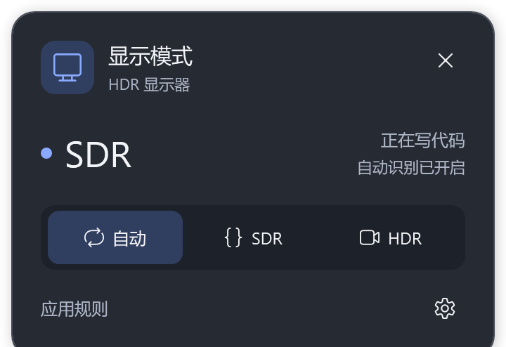
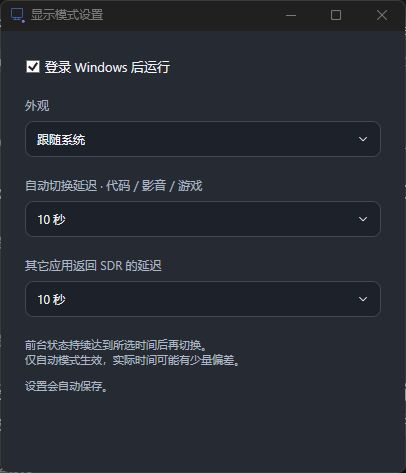

<div align="center">

# FluentHDR

**SDR for coding. HDR for videos and games.**

A Fluent-style Windows tray app that switches display modes as you switch apps.

**English** · [简体中文](README.md)


[](LICENSE)

[Download](https://github.com/krfnsa-lab/FluentHDR/releases/latest) · [Quick start](#quick-start) · [Usage](#usage) · [Build](#build-from-source)

</div>

---

FluentHDR watches the foreground app and switches Windows HDR on or off according to your rules. Keep SDR while working in an editor or terminal, use HDR in a video player or game, or choose a fixed mode from the tray.

## Preview

<table>
  <tr>
    <th align="center">Tray panel</th>
    <th align="center">Theme and delay settings</th>
  </tr>
  <tr>
    <td align="center" valign="top"></td>
    <td align="center" valign="top"></td>
  </tr>
</table>

> The app interface is currently in Chinese. This README is available in English and Simplified Chinese.

## Features

- **Automatic or manual control** — switch by foreground app, or lock SDR / HDR with one click.
- **Fluent-style tray panel** — light, dark, or system theme; no desktop shortcut clutter.
- **Editable app rules** — add editors, players, games, and game installation folders without restarting.
- **Separate delays** — tune recognized-app switching and the return to SDR independently.
- **Actual display status** — the panel reports the monitor's current mode, not just the selected policy.
- **Local operation** — no account, network connection, or administrator privileges required to use the app.

## Quick start

### Requirements

- **Windows 11 x64** with an HDR-capable display and HDR supported by Windows for that display.
- **Windows PowerShell 5.1** and **.NET Framework 4.8 or later**. These are normally already available on Windows 11; no .NET SDK is needed.

### Install

1. Download the ZIP package from the [latest release](https://github.com/krfnsa-lab/FluentHDR/releases/latest).
2. Extract the **entire ZIP** into a folder, then double-click `Install.cmd`.
3. Click the monitor icon in the Windows notification area. If it is hidden, expand the tray overflow.

Installation enables **Auto mode** and **run at login** by default. Search the Start menu for **“HDR 显示模式”** to reopen the panel. You can move or delete the extracted package after installation; the installed app runs from its own folder.

## Usage

### Modes

| Mode | What it does |
| --- | --- |
| **Auto / 自动** | Switches SDR / HDR using foreground-app rules and your chosen delays. |
| **SDR** | Keeps HDR off until you choose another mode. |
| **HDR** | Keeps HDR on until you choose another mode. |

The large **SDR / HDR** label shows the actual display state. The selected button shows the control mode. A blue dot indicates SDR; a purple dot indicates HDR. You can also switch modes by right-clicking the tray icon.

### Automatic rules

| Foreground app | Default behavior |
| --- | --- |
| Recognized editor or terminal | SDR, even when a video is playing in the background. |
| Recognized video player | HDR while the player is in the foreground. |
| Recognized game or app inside a configured game folder | HDR. Launchers and known utilities are excluded. |
| Browser with a matching video media session | HDR. Known video-site titles in fullscreen can also trigger HDR. |
| Other apps | Return to SDR after the separate fallback delay. |

Open **应用规则** (App rules) to add or remove editor, player, or game processes and game folders. Changes take effect automatically. Browser detection depends on the information exposed by Windows, the browser, and the website; use manual HDR if a video is not recognized.

### Delays and appearance

Click the **gear icon → 设置** (Settings).

| Setting | Applies to | Default |
| --- | --- | --- |
| **自动切换延迟** — Automatic switching delay | Recognized editors, players, games, and browser video | 2 seconds |
| **其它应用返回 SDR 的延迟** — Return-to-SDR delay for other apps | Apps that fall back to SDR | 8 seconds |

Both settings offer **1, 2, 3, 5, 8, 10, 15, 30, or 60 seconds** and save automatically. The corresponding state must remain stable for the chosen delay; polling and display response can add a small amount of time. These delays apply only to Auto mode.

Settings also include **system / light / dark theme** and **run at login**.

## FAQ

### Does it enable HDR only for one app?

No. Windows HDR is a display-wide setting and affects every window on that monitor. By default, FluentHDR controls all currently connected, active HDR-capable displays; unsupported displays are left unchanged.

### Does it turn SDR videos or games into HDR?

Enabling Windows HDR output does not convert SDR content into native HDR. The result depends on your display, content, and the video player's or game's own HDR settings.

### Why does a browser video sometimes stay in SDR?

Automatic detection uses Windows media sessions, the foreground page title, and a fullscreen fallback for known video sites. Some browsers or sites do not expose enough information. Select **HDR** manually for that session, then select **Auto** to resume automatic switching.

### What happens when I exit the app?

Right-click the tray icon and choose **退出** (Exit) to stop the app and automatic switching. Your current display mode is preserved. Disable **登录 Windows 后运行** (Run after signing in to Windows) in Settings first if you also want to stop the app from launching at the next login.

## Build from source

Run these commands from the repository root on Windows 11 x64:

```powershell
# Build the tray app and icon using the Windows .NET Framework compiler
powershell -NoProfile -ExecutionPolicy Bypass -File .\Build.ps1

# Install and launch the built app
powershell -NoProfile -ExecutionPolicy Bypass -File .\Setup.ps1
```

Run the rule and UI regression tests:

```powershell
powershell -NoProfile -ExecutionPolicy Bypass -File .\tests\Run.ps1
```

The tests do not change HDR or start the background watcher.

Create a release ZIP and SHA-256 checksum:

```powershell
powershell -NoProfile -ExecutionPolicy Bypass -File .\Package.ps1 -Version v0.1.0
```

The package script builds and tests before writing to `dist/`. `-ExecutionPolicy Bypass` applies only to that PowerShell process; these commands do not change the system-wide execution policy.

<details>
<summary><strong>Advanced configuration, maintenance, and privacy</strong></summary>

### Files and configuration

| Location | Contents |
| --- | --- |
| `%LOCALAPPDATA%\CodexHdrSwitch\App` | Installed executable, runtime files, and active `config.json`. |
| `%LOCALAPPDATA%\CodexHdrSwitch` | Theme settings, mode override, worker status, and logs. |
| Repository `config.json` | Defaults shipped with the app. |

`CodexHdrSwitch` is a retained internal directory name. Reinstalling preserves the installed rules and delays, enables run at login, and restores Auto mode. Pass `-KeepMode` to `Setup.ps1` to retain a fixed SDR / HDR mode, or `-ResetRules` to restore the package's default configuration.

For a specific monitor, set `TargetDisplays` in the installed `config.json` to an array of exact display names, Windows device names, monitor device paths, or display keys. An empty array selects all active HDR-capable displays. Inspect available displays with:

```powershell
powershell -NoProfile -ExecutionPolicy Bypass -File "$env:LOCALAPPDATA\CodexHdrSwitch\App\HdrSwitch.ps1" -Mode Status
```

### Startup, exit, and uninstall

Disable **登录 Windows 后运行** (Run after signing in to Windows) in Settings to turn off login startup. Right-click the tray icon and choose **退出** (Exit) to stop the app and automatic switching; exiting keeps the current display mode.

To uninstall, disable login startup, exit the app, then delete `%LOCALAPPDATA%\CodexHdrSwitch` and the **HDR 显示模式** Start menu shortcut.

### Privacy and assets

App classification runs locally. The installed tool does not connect to the network. Switching logs contain process names and reasons, not browser page or video titles. The icon uses the Windows-provided **Segoe Fluent Icons** font; font files are not redistributed.

</details>

## License

FluentHDR is released under the [MIT License](LICENSE). Windows system fonts are not included in this repository or the release package.
